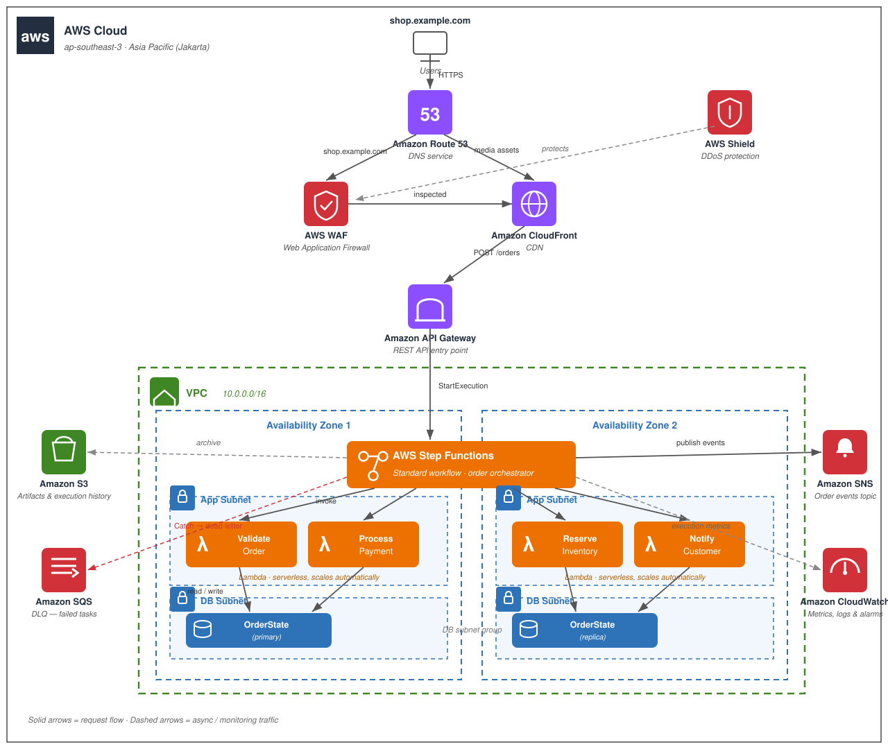

# AWS Step Functions — Durable Serverless Workflows


## TL;DR

Stop chaining Lambdas together with SQS duct tape and tribal knowledge. **AWS Step Functions** turns a multi-step process into a visual, retryable, auditable state machine: each execution is a traceable run with the exact input/output of every step. **Standard** workflows for long-running, exactly-once sagas (order processing, approvals); **Express** for high-volume, short event processing (IoT ingestion, stream transforms).

## The problem it solves

A typical "serverless order flow" without orchestration looks like this: API Gateway → Lambda A → SQS → Lambda B → SNS → Lambda C, plus DLQs, plus retries configured in three different consoles, plus a 2 AM page where you grep six CloudWatch log groups to reconstruct one failed order.

Step Functions centralises the flow. The state machine *is* the documentation: one console shows the execution graph, which step failed, what the input was, and where the retry policy kicked in.

## Architecture



Traffic flow: **Users → Route 53 → WAF → CloudFront → API Gateway → Step Functions (Standard)**. The workflow fans out to Lambda tasks across two AZs — *Validate Order*, *Process Payment*, *Reserve Inventory*, *Notify Customer* — with order state in DynamoDB (primary + replica), failed tasks parked in an SQS DLQ, domain events published to SNS, execution history archived to S3, and everything observed in CloudWatch.

## The workflow, state by state

The full machine is in [`order-workflow.asl.json`](./order-workflow.asl.json). Cheat sheet of the states it uses:

| State | Does what | Used here for |
|---|---|---|
| `Task` | Calls a Lambda or an optimised AWS service integration | All worker steps |
| `Choice` | Branches on data, no Lambda needed | Fraud score > 80 → reject before touching payment |
| `Parallel` | Runs branches concurrently, waits for all | Payment **and** inventory at the same time |
| `Retry` | Re-runs the same state with backoff | Transient Lambda SDK errors |
| `Catch` | Routes to a *different* state on failure | Compensation (saga) or DLQ |
| `Fail` / `Succeed` | Terminal states with typed errors | Clean, searchable failure reasons |

## Standard vs Express — pick correctly

| | **Standard** | **Express** |
|---|---|---|
| Max duration | 1 year | 5 minutes |
| Semantics | Exactly-once | At-least-once |
| Pricing | Per state transition (~$0.025 / 1k) | Per request + GB-seconds |
| Visibility | Full execution history | CloudWatch Logs only |
| Use for | Order sagas, approvals, ETL | IoT ingestion, streaming, fire-and-forget |

Rule of thumb: if a human might ask *"what exactly happened to order #48291?"* six months from now — Standard.

## Step Functions vs the alternatives

| Approach | Best when | The pain |
|---|---|---|
| Raw Lambda + SQS chains | 2 steps, genuinely simple | Flow logic scattered across consoles |
| EventBridge choreography | Decoupled fan-out, many independent consumers | No central view; sagas are hard to debug |
| **Step Functions** | Ordered multi-step flows, retries, audit | Per-transition cost at extreme scale |

They compose, too: this repo's diagram ends the workflow with an SNS publish — orchestrate the saga, choreograph the domain events.

## Error handling that actually works

Three layers, all in the JSON — no extra infrastructure:

1. **Retry with backoff** — `Lambda.ServiceException` gets 3 attempts, doubling the interval. Transient blips disappear without paging anyone.
2. **Saga compensation** — each `Parallel` branch has a `Catch`: failed payment → `RefundPayment`; failed inventory → `ReleaseInventory`. A workflow-level `Catch` runs `CompensateOrder` for anything that already completed. Explicit undo > distributed locks.
3. **Poison messages to DLQ** — `SendToDLQ` uses the optimised SQS integration (`arn:aws:states:::sqs:sendMessage`), so parking a bad payload needs zero Lambda code.

One non-negotiable: **every task must be idempotent**. A retry re-runs side effects — charge the card twice and your saga just created a support ticket. Key everything on `orderId`.

## Run it

```bash
# validate the definition first (catches JSON/ASL mistakes early)
aws stepfunctions validate-state-machine-definition \
  --definition file://order-workflow.asl.json \
  --type STANDARD

aws stepfunctions create-state-machine \
  --name order-workflow \
  --definition file://order-workflow.asl.json \
  --role-arn arn:aws:iam::123456789012:role/StepFunctionsExecutionRole

aws stepfunctions start-execution \
  --state-machine-arn arn:aws:states:ap-southeast-3:123456789012:stateMachine:order-workflow \
  --input '{"orderId":"ord-48291","amount":499000,"fraudScore":12}'
```

> Replace the placeholder account ID and Lambda ARNs with your own. The execution role needs `lambda:InvokeFunction`, `dynamodb:*` on the state table, `sqs:SendMessage` on the DLQ, and `sns:Publish` on the events topic — least privilege, as always.

## Cost snapshot

| Workflow | Unit | Approx. price |
|---|---|---|
| Standard | 1,000 state transitions | $0.025 |
| Express | 1M requests + duration | $1.00 + $0.00001667/GB-s |

An order flow with ~8 states at 100k orders/month ≈ **$20/month** on Standard — cheaper than the on-call time of one bad night. (Check current regional pricing; Jakarta region can differ slightly.)

## Project structure

```
aws-step-functions-guide/
├── README.md                 # this guide
├── architecture.svg          # classic AWS reference-style diagram
├── order-workflow.asl.json   # deployable state machine (Amazon States Language)
└── quiz.md                   # 5 questions + collapsed answers
```

## Quiz teaser

Think you've got it? [`quiz.md`](./quiz.md) has 5 questions: Standard vs Express at 2M events/hour, `Retry` vs `Catch`, why idempotency is non-negotiable, the saga pattern in this workflow, and when to still pick EventBridge. Answers are collapsed — no peeking. 👀

## Further reading

- [AWS Step Functions — Standard vs Express](https://docs.aws.amazon.com/step-functions/latest/dg/concepts-standard-vs-express.html)
- [AWS Prescriptive Guidance — Saga pattern on AWS](https://docs.aws.amazon.com/prescriptive-guidance/latest/modernization-data-persistence/saga-pattern.html)
- [Error handling in Step Functions](https://docs.aws.amazon.com/step-functions/latest/dg/concepts-error-handling.html)
